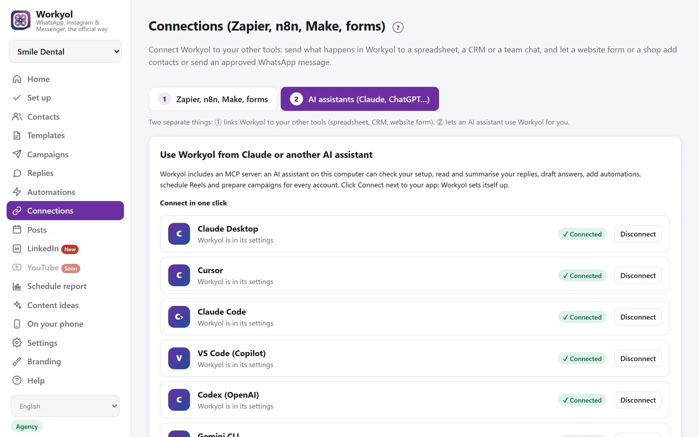

# Workyol skill for Claude

Run Workyol from Claude: WhatsApp campaigns, one inbox for WhatsApp, Instagram and Messenger, auto-replies, comment-to-DM, Google reviews and Google posts, and scheduled Reels, LinkedIn posts and YouTube videos.



## Official APIs. No ban risk.

Workyol uses Meta's official platforms: the WhatsApp Business Platform (Cloud API), Instagram and Messenger. It uses LinkedIn's official API for LinkedIn posts, Google's Business Profile API for Google reviews and Google posts, and Google's YouTube API for YouTube (YouTube is not open to customers yet). It uses no WhatsApp Web hacks, so there is no risk of a ban for using unofficial tools.

Bans come from messaging people who did not agree. Workyol works only with opted-in contacts, handles STOP for you, and the assistant always asks before it sends or publishes.

## Google reviews (new)

- See the reviews of your Google Business Profile, for every location, and answer them in the reviewer's language with a draft you check before it is posted.
- Schedule Google posts (offers, events, news, with a Call now or Book button) next to your Instagram, Facebook and LinkedIn posts.
- Get your Google numbers: views on Search and Maps, calls, website clicks, direction requests, and new reviews per month.

Built on Google's official Business Profile API. Needs Workyol 1.14 or later. Already have the skill? Update it with `git pull`.

## Coming soon

- **YouTube for everyone.** Scheduled YouTube uploads open to all customers once Google's review is done.

## What you need

- The **Workyol app**, installed and running on your computer (Windows, Mac or Linux). Free 7-day trial: https://workyol.com/?ref=skill-github
- An AI assistant that supports skills and MCP servers (Claude Code, Claude Desktop, claude.ai).
- Workyol's MCP server connected (below).

This skill is free and MIT-licensed. The app has its own licence.

## Install the skill

**Claude Code**

Copy this folder to `~/.claude/skills/workyol/`, or clone it there:

```
git clone https://github.com/afrikyol/workyol-skill.git ~/.claude/skills/workyol
```

**Claude Desktop / claude.ai**

Zip the folder (the zip must contain `SKILL.md`). Go to Settings, Capabilities, Skills, and upload the zip.

## Connect the MCP server

In Workyol: **Connections**, then the tab **AI assistants (Claude, ChatGPT…)**, then **Connect** next to your app (Claude Desktop, Claude Code, Cursor, VS Code…). Restart that app once. Workyol must stay open while the assistant works.

For Claude Code, the command looks like this (change the path to your Workyol folder):

```
claude mcp add workyol --scope user -e WORKYOL_URL=http://127.0.0.1:4747 -- node "C:\path\to\Workyol\mcp\workyol-mcp.js"
```

If your dashboard has a password, also set `WORKYOL_PASSWORD`. Workyol must be running.

Then ask Claude: "Check my Workyol setup."

**Tip:** Claude can use the Workyol tools without opening this skill. To get its step-by-step guide, say so at the start of your request, for example: "First load the workyol skill, then check my replies."

## Example prompts

- Check my Workyol setup and tell me what is missing.
- Summarise my unread replies and draft answers. Show them to me before sending.
- Prepare a WhatsApp campaign with an approved template for my opted-in list. Show me the preview first.
- Add an auto-reply: when someone writes CATALOG, send my PDF.
- When someone comments PRICE under my post, send them a private message.
- Schedule these 5 videos as Reels, one each day at 18:00.
- Schedule 12 LinkedIn posts over 6 weeks and show them to me first.
- Draft replies to my unanswered Google reviews, each in the reviewer's language.
- Schedule a Google post with a Call now button for Friday 09:00.
- How many people found us on Google Maps last month?

## Safety

- Nothing is sent or published until you say yes. The assistant shows a summary first.
- Campaigns go only to contact lists with the opt-in box ticked. No tool can add phone numbers.
- The assistant never sees your access tokens, App secret or licence key.
- Google review replies are public: the assistant shows every draft first. It never writes fake reviews or offers anything in exchange for a review.
- Workyol's own rules still apply: 24-hour WhatsApp window, opt-outs, approved templates, licence.

## Licence

MIT, Copyright (c) 2026 Afrikyol, LLC.

---

## Français

Workyol pilote WhatsApp, Instagram et Messenger depuis Claude : campagnes WhatsApp vers des contacts qui ont donné leur accord, boîte de réception unique, réponses automatiques, commentaire vers message privé, et publications programmées (Reels, LinkedIn). Il utilise les API officielles de Meta : pas de risque de bannissement lié à des outils non officiels. Rien n'est envoyé sans votre accord.
Nouveau : les avis Google (voir les avis, alerte à chaque nouvel avis, réponse proposée par l'IA que vous validez), les publications Google et les chiffres Google (vues sur Search et Maps, appels, itinéraires), via l'API officielle de Google.
Application et essai gratuit : https://workyol.com/?ref=skill-github

## Türkçe

Workyol, Claude ile WhatsApp, Instagram ve Messenger'ı yönetir: onay vermiş kişilere WhatsApp kampanyaları, tek gelen kutusu, otomatik yanıtlar, yorumdan özel mesaja ve zamanlanmış paylaşımlar (Reels, LinkedIn). Meta'nın resmi API'lerini kullanır; resmi olmayan araçlardan kaynaklanan yasaklanma riski yoktur. Siz onaylamadan hiçbir şey gönderilmez.
Yeni: Google yorumları (yorumları görme, her yeni yorumda uyarı, sizin onayladığınız yapay zekâ yanıt taslağı), Google gönderileri ve Google rakamları (Search ve Maps görüntülemeleri, aramalar, yol tarifleri), Google'ın resmi API'si ile.
Uygulama ve ücretsiz deneme: https://workyol.com/?ref=skill-github

## العربية

يتيح Workyol التحكم في واتساب وإنستغرام وماسنجر من Claude: حملات واتساب لجهات الاتصال التي وافقت على تلقي الرسائل، وصندوق وارد واحد، وردود تلقائية، والتعليق إلى رسالة خاصة، ونشر مجدول (Reels وLinkedIn). يستخدم واجهات Meta الرسمية، فلا خطر حظر بسبب أدوات غير رسمية. لا يُرسل شيء قبل موافقتك.
جديد: تقييمات Google (عرض التقييمات، تنبيه عند كل تقييم جديد، ورد مقترح بالذكاء الاصطناعي تراجعه قبل النشر)، ومنشورات Google، وأرقام Google (المشاهدات على Search وMaps، والمكالمات، وطلبات الاتجاهات) عبر واجهة Google الرسمية.
التطبيق وتجربة مجانية: https://workyol.com/?ref=skill-github
